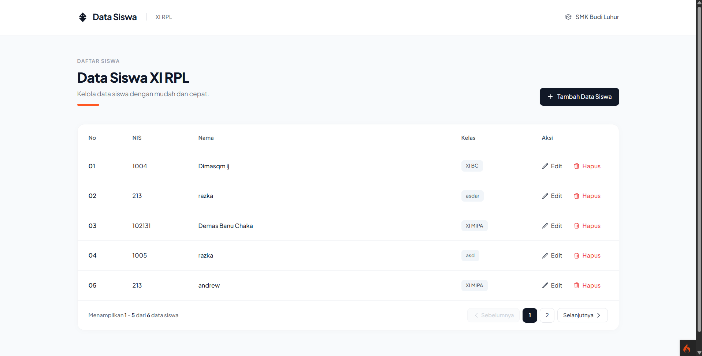

# Redesign Data Siswa - SMK Budi Luhur (XI RPL)

Aplikasi manajemen Data Siswa berbasis **CodeIgniter 4** yang telah diredesain secara modern dan bersih menggunakan **Tailwind CSS** dan Google Font **Plus Jakarta Sans**, sesuai pedoman antarmuka SMK Budi Luhur.

---

## 📸 Preview Hasil Desain (Untuk Pak Rinto)

---

## ✨ Fitur & Pembaruan
1. **Redesign UI Modern (SMK Budi Luhur Theme)**:
   - Header & Navbar elegan dengan logo, label kelas XI RPL, dan identitas SMK Budi Luhur.
   - Tabel modern berbasis card melengkung (`rounded-2xl`), shadow lembut, aksen oranye `#ff5722`, dan badge kelas.
   - Modal popup Tambah & Edit Data Siswa yang selaras dengan tema UI.
2. **Pagination Otomatis (Maksimal 5 Data Per Halaman)**:
   - Maksimal 5 data siswa per halaman.
   - Tombol navigasi halaman (1, 2, ...) serta tombol *Sebelumnya* dan *Selanjutnya*.
   - Penomoran dinamis otomatis sesuai halaman aktif (Halaman 1: 01-05, Halaman 2: 06-10, dst.).
3. **CRUD Data Siswa Terintegrasi Database**:
   - Tambah Data Siswa.
   - Edit / Perbarui Data Siswa.
   - Hapus Data Siswa dengan konfirmasi alert.
4. **Design Specification**:
   - Detail token warna, tipografi, dan komponen dicatat di [`design.md`](design.md).

---

## 🛠️ Teknologi yang Digunakan
- **Backend**: CodeIgniter 4 (PHP 8.2+)
- **Database**: MySQL / MariaDB
- **Frontend / Styling**: Tailwind CSS, Google Fonts (Plus Jakarta Sans)
- **Server**: Laragon / Apache
